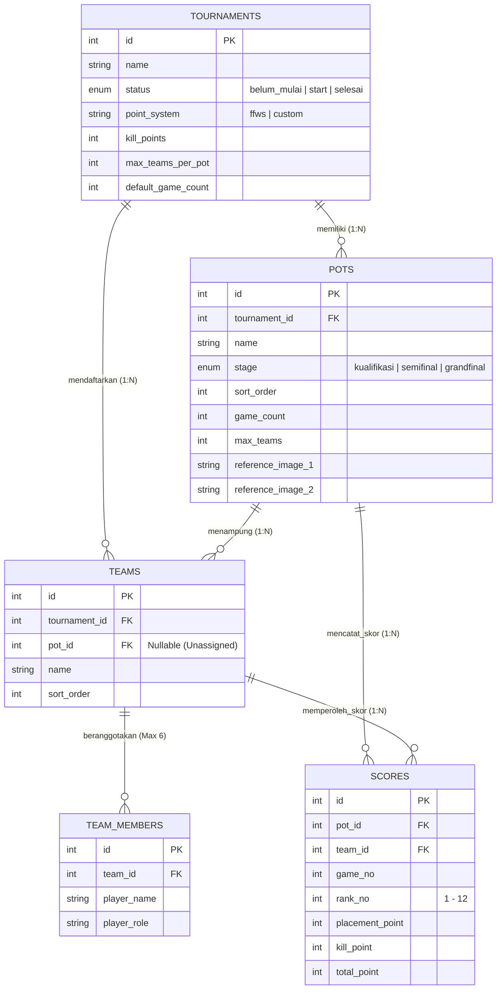

<div align="center">

# 🎯 BATTLEGROUND CALC (`bgcalc`)
### High-Speed Esports Tournament Score Engine & Multi-Stage Roster Management System

[](https://www.php.net/)
[](https://codeigniter.com/)
[](https://www.mysql.com/)
[](https://www.docker.com/)
[](https://docusaurus.io/)
[](#)

<p align="center">
  <strong>Battleground Calc</strong> adalah platform manajemen turnamen <em>battle royale esports</em> (Free Fire / PUBG Mobile) berkecepatan tinggi dengan antarmuka <em>Zero-Border-Radius Dark Utilitarian</em>. Dirancang khusus untuk operator turnamen guna menangani alokasi tim, promosi lintas babak (<em>Kualifikasi &rarr; Semifinal &rarr; Grand Final</em>), dan kalkulasi skor <em>real-time</em> bergaya <em>Spreadsheet / Excel</em>.
</p>

[🚀 Quick Start](#-quick-start-docker--wsl2) •
[🏗️ Arsitektur Sistem](#️-arsitektur-sistem--skema-data) •
[⚡ Fitur Unggulan](#-fitur-unggulan-engineering-highlights) •
[🧮 Rumus Kalkulasi](#-aturan-bisnis--kalkulasi-poin) •
[📖 Dokumentasi (Docusaurus)](#-ekosistem-dokumentasi-bgcalc-docs)

</div>

---

## ⚡ Fitur Unggulan (*Engineering Highlights*)

Proyek ini dibangun dengan fokus pada **kecepatan input operator (Zero-Lag UI)**, **integritas transaksi database**, dan **otomasi penempatan grup (Pot)**:

### 1. 📊 Pro Spreadsheet / Excel-Like Score Calculator
* **Navigasi Keyboard Penuh:** Mendukung perpindahan sel instan menggunakan tombol panah (`↑` `↓` `←` `→`) dan tombol `Enter` (langsung turun 1 baris pada kolom *Game* yang sama untuk input cepat *Rank 1–12*).
* **Auto-Select & Live Calculation:** Memilih sel otomatis memblok angka lama untuk penimpaan instan, dengan kalkulasi *Placement Point* dan *Total Point* secara *real-time* di sisi klien (*Client-Side*) sekaligus *Autosave* berbasis antrean transaksi (*Promise-queued AJAX*).
* **Stage Switcher & Presentation Mode:** Filter cepat antar babak (*Kualifikasi*, *Semifinal*, *Grand Final*) dan tombol *Mode Bersih (Hide Controller)* untuk kebutuhan *livestreaming* / *screenshot* klasemen.

### 2. 🤖 Smart Pot Allocator & Auto-Overflow Engine
* **Zero-Config Pot Assignment:** Menambahkan tim baru tanpa menentukan nama Pot akan otomatis menempatkan tim ke Pot paling atas yang tersedia pada babak aktif.
* **Automatic Spillover (Overflow):** Jika `POT 1` sudah mencapai kapasitas maksimal (misal $12/12$ tim), tim ke-13 dan seterusnya otomatis dialihkan ke `POT 2`, `POT 3`, dst.
* **Magic Pot Auto-Creation:** Jika seluruh Pot yang ada telah penuh, sistem secara otomatis membuatkan Pot nomor berikutnya beserta konfigurasi *default* turnamen tanpa interupsi error.

### 3. 🧩 Interactive Drag & Drop Team Manager (Multi-Pot Support)
* **Dual-Mode Dragging (SortableJS Engine):**
  * **Mode Pindah Biasa (*Move*):** Memindahkan tim dari gudang *Unassigned Teams* ke Pot pertandingan atau menukar posisi antar Pot.
  * **Mode Promosi Babak (*Multi-Pot Clone*):** Menyalin tim yang lolos dari Pot Kualifikasi ke Pot Semifinal/Grand Final beserta seluruh anggota *roster*-nya **tanpa menghapus** riwayat tim dan skor di babak sebelumnya.
* **Dirty-State Tracking:** Hanya mengirimkan perubahan (*delta payload*) ke server dilengkapi penanda status perubahan visual secara *real-time*.

### 4. 🛡️ Hardened Security & Transactional Integrity
* **State Lockdown:** Turnamen dengan status `selesai` (*Finished*) dikunci secara mutlak di level *Controller* terhadap segala bentuk mutasi skor, pot, maupun tim.
* **Detach vs Hard Delete Separation:** Menghapus tim dari halaman kalkulator skor hanya melakukan *soft-detach* (`pot_id = NULL`) agar histori data tim tidak hilang, sedangkan penghapusan permanen (*Hard Delete*) terisolasi di halaman *Roster Hub*.
* **CSRF Auto-Synchronization:** Sinkronisasi otomatis token keamanan CodeIgniter 4 pada setiap *request* AJAX beruntun.

---

## 🏗️ Arsitektur Sistem & Skema Data

### Hierarki Entitas & Alur Data



### Struktur Direktori Proyek

```text
/root/project/
├── htdocs/                          # Core Application (CodeIgniter 4.7.3)
│   ├── app/
│   │   ├── Config/                  # Konfigurasi Routes, Shield Auth, & Database
│   │   ├── Controllers/             # Logika Bisnis (Tournament, Pot, Team, Score, Import)
│   │   ├── Filters/                 # Security Filters (LocalOnlyFilter, Session, Idle)
│   │   ├── Models/                  # Data Access Layer & Validasi Entitas
│   │   └── Views/                   # Antarmuka Pengguna (Dark Utilitarian UI)
│   │       ├── layouts/main.php     # Master Shell (Off-Canvas Sidebar & Topbar)
│   │       ├── scores/              # Pro Spreadsheet Calculator Views
│   │       └── teams/               # Roster Hub & Drag-and-Drop Manager
│   ├── public/
│   │   └── assets/
│   │       ├── css/                 # Modular Stylesheets (dark-app.css, dashboard-layout.css)
│   │       └── js/                  # Consolidated JS Engines (app-shell.js, score-workspace.js)
│   ├── Dockerfile                   # PHP 8.2-Apache Container Image Definition
│   └── docker-compose.yml           # Multi-Container Orchestration (App + MySQL 8.0)
│
└── bgcalc-docs/                     # Documentation Engine (Docusaurus v3.10.2)
    ├── docs/                        # Dokumentasi Teknis & Blueprint Arsitektur
    ├── docusaurus.config.js         # Konfigurasi Docusaurus & Mermaid Theme
    └── sidebars.js                  # Struktur Navigasi Dokumentasi Otomatis
```

---

## 🧮 Aturan Bisnis & Kalkulasi Poin

Setiap pertandingan (*Game*) di dalam suatu *Pot* menghitung skor total tim menggunakan persamaan linear berikut:

$$\text{Total Point} = \text{Placement Point}(\text{Rank}) + (\text{Kill Point} \times \text{Kill Multiplier})$$

### Tabel Konversi *Placement Point* Standar (FFWS System)

| Peringkat (*Rank*) | Placement Point | Peringkat (*Rank*) | Placement Point |
| :---: | :---: | :---: | :---: |
| **#1 (*Booyah*)** | $12\text{ pt}$ | **#7** | $4\text{ pt}$ |
| **#2** | $9\text{ pt}$ | **#8** | $3\text{ pt}$ |
| **#3** | $8\text{ pt}$ | **#9** | $2\text{ pt}$ |
| **#4** | $7\text{ pt}$ | **#10** | $1\text{ pt}$ |
| **#5** | $6\text{ pt}$ | **#11** | $0\text{ pt}$ |
| **#6** | $5\text{ pt}$ | **#12** | $0\text{ pt}$ |

* **Batas Peringkat:** $\text{Rank} \in \{1, 2, \dots, 12\}$ dan $\text{Kill Point} \ge 0$.
* **Custom Point System:** Mendukung skema poin kustom per turnamen melalui daftar nilai terpisah koma (*comma-separated values*) yang dievaluasi secara dinamis di sisi server maupun *client*.

---

## 🚀 Quick Start (Docker & WSL2)

Lingkungan pengembangan dan produksi menggunakan **Docker Compose** yang berjalan di atas **WSL2 (Ubuntu)** untuk performa I/O sistem file Linux yang optimal.

### Prasyarat
* **Windows 10/11 x64** dengan **WSL2 (Ubuntu)** aktif.
* **Docker Desktop** (dengan integrasi WSL2 aktif).
* **Node.js v18+** & **npm** (untuk menjalankan dokumentasi Docusaurus).

### 1. Menjalankan Aplikasi Utama (`battleground-calc`)

```bash
# 1. Masuk ke direktori proyek di dalam WSL2
cd /root/project/htdocs

# 2. Bangun dan jalankan container di background
docker compose up -d --build

# 3. Pastikan izin folder writable terbuka penuh untuk session & cache
docker exec -it ci4_app chmod -R 777 writable/

# 4. Regenerasi autoloader Composer & jalankan migrasi database
docker exec -it ci4_app composer dump-autoload
docker exec -it ci4_app php spark migrate
```

Akses aplikasi melalui browser:
* **Web Application:** [http://localhost:8080](http://localhost:8080)
* **MySQL Database Port (Host):** `localhost:3307` (User: `ci4_user` | Pass: `ci4_password` | DB: `ci4_db`)

<details>
<summary><strong>⚙️ Konfigurasi <code>.env</code> CodeIgniter 4 (Klik untuk membuka)</strong></summary>

Pastikan file `/root/project/htdocs/.env` memiliki konfigurasi berikut:

```ini
CI_ENVIRONMENT = development

app.baseURL = "http://localhost:8080/"
app.indexPage = ""

database.default.hostname = db
database.default.database = ci4_db
database.default.username = ci4_user
database.default.password = ci4_password
database.default.DBDriver = MySQLi
database.default.port     = 3306
```
</details>

---

## 📖 Ekosistem Dokumentasi (`bgcalc-docs`)

Dokumentasi arsitektur lengkap dikelola menggunakan **Docusaurus v3.10.2** yang mendukung diagram visual **Mermaid.js**.

```bash
# 1. Masuk ke direktori dokumentasi
cd /root/project/bgcalc-docs

# 2. Instal dependensi & plugin Mermaid (jika belum)
npm install
npm install --save @docusaurus/theme-mermaid

# 3. Jalankan server dokumentasi lokal pada port 3001
npm run start -- --port 3001 --host 0.0.0.0
```

* **Documentation Portal:** [http://localhost:3001](http://localhost:3001)

---

## 🔌 Referensi Endpoint & Rute Utama

<details>
<summary><strong>📋 Lihat Daftar Lengkap Rute HTTP & AJAX API (Klik untuk membuka)</strong></summary>

| Modul | Method | URI Endpoint | Controller Method | Deskripsi |
| :--- | :---: | :--- | :--- | :--- |
| **Dashboard** | `GET` | `/` atau `/dashboard` | `Dashboard::index` | Ringkasan turnamen & statistik utama |
| **Tournaments** | `POST` | `/tournaments/store` | `TournamentController::store` | Membuat turnamen baru |
| **Tournaments** | `POST` | `/tournaments/update-status/(:num)` | `TournamentController::updateStatus` | Mengubah status (`belum_mulai`, `start`, `selesai`) |
| **Pots** | `GET` | `/tournaments/(:num)/pots` | `PotController::index` | Daftar pot dalam turnamen |
| **Pots** | `POST` | `/pots/store` | `PotController::store` | Membuat pot baru pada tahapan tertentu |
| **Pots** | `POST` | `/pots/advance/(:num)` | `PotController::advanceSelected` | Mempromosikan tim terpilih ke pot babak berikutnya |
| **Scores** | `GET` | `/pots/(:num)/scores` | `ScoreController::index` | Halaman **Pro Spreadsheet Score Calculator** |
| **Scores** | `POST` | `/scores/save-bulk` | `ScoreController::saveBulk` | *Replace-state bulk save* seluruh skor dalam pot |
| **Teams** | `GET` | `/teams/roster` | `TeamController::rosterIndex` | Halaman **Team Management Hub (Mass Roster Editor)** |
| **Teams** | `POST` | `/teams` atau `/teams/store` | `TeamController::store` | Tambah tim manual dengan *Smart Pot Auto-Overflow* |
| **Teams** | `POST` | `/teams/bulk-update` | `TeamController::bulkUpdate` | Simpan perubahan massal daftar tim & anggota |
| **Drag Manager** | `GET` | `/teams/drag-manager` | `TeamController::dragManager` | Antarmuka visual **Drag & Drop Team Manager** |
| **Drag Manager** | `POST` | `/teams/drag-manager/save` | `TeamController::saveDragManager` | Bulk API penyimpanan posisi pot & kloning promosi tim |
| **Imports** | `GET/POST` | `/imports/raw-csv` | `RawCsvController::index` | Import tim & roster massal via CSV/Excel |
| **Leaderboard** | `GET` | `/leaderboard/pot/(:num)` | `LeaderboardController::pot` | Tampilan klasemen publik per pot |

</details>

---

## 🛠️ Utilitas & Troubleshooting

<details>
<summary><strong>1. Saklar Hypervisor Windows (Konflik Docker vs Emulator Game LDPlayer)</strong></summary>

Jika menggunakan PC yang sama untuk menjalankan Docker (butuh *Hyper-V / WSL2*) dan Emulator Android seperti LDPlayer:
* Jalankan **`MODE_DOCKER.bat`** (Run as Administrator) lalu *restart* Windows sebelum bekerja dengan Docker & WSL2:
  ```bat
  bcdedit /set hypervisorlaunchtype auto
  shutdown /r /t 0
  ```
* Jalankan **`MODE_GAME_LDPLAYER.bat`** (Run as Administrator) lalu *restart* jika ingin mematikan Hypervisor sementara:
  ```bat
  bcdedit /set hypervisorlaunchtype off
  shutdown /r /t 0
  ```
</details>

<details>
<summary><strong>2. Perbaikan Error Database <code>Duplicate entry '0' for key 'PRIMARY'</code></strong></summary>

Jika setelah mengimpor dump SQL dari server eksternal terjadi error `Duplicate entry '0'`, jalankan perintah perbaikan `AUTO_INCREMENT` berikut di terminal WSL:

```bash
docker exec -i ci4_mysql mysql -uci4_user -pci4_password ci4_db -e "
SET FOREIGN_KEY_CHECKS = 0;
ALTER TABLE tournaments MODIFY COLUMN id INT UNSIGNED NOT NULL AUTO_INCREMENT;
ALTER TABLE pots MODIFY COLUMN id INT UNSIGNED NOT NULL AUTO_INCREMENT;
ALTER TABLE teams MODIFY COLUMN id INT UNSIGNED NOT NULL AUTO_INCREMENT;
ALTER TABLE team_members MODIFY COLUMN id INT UNSIGNED NOT NULL AUTO_INCREMENT;
ALTER TABLE scores MODIFY COLUMN id INT UNSIGNED NOT NULL AUTO_INCREMENT;
SET FOREIGN_KEY_CHECKS = 1;
"
```
</details>

<details>
<summary><strong>3. Deadlock Socket WSL2 / Docker Desktop (<code>backend.sock / exit status 1</code>)</strong></summary>

Jika Docker gagal terhubung ke distro Ubuntu di WSL2, jalankan perintah berikut melalui **PowerShell (Admin)**:
```powershell
wsl --shutdown
net stop com.docker.service
net start com.docker.service
```
</details>

---

<div align="center">
  <sub>Built with precision for Competitive Esports Tournament Operations &bull; <strong>Battleground Calc Engineering Team</strong></sub>
</div>